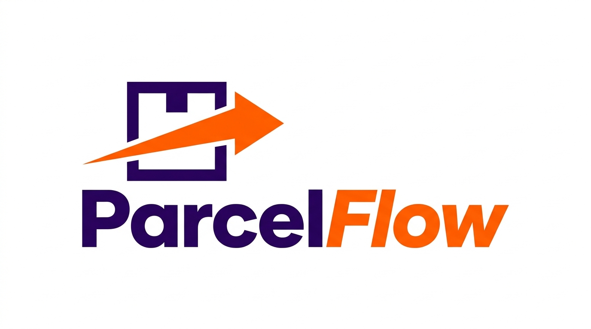
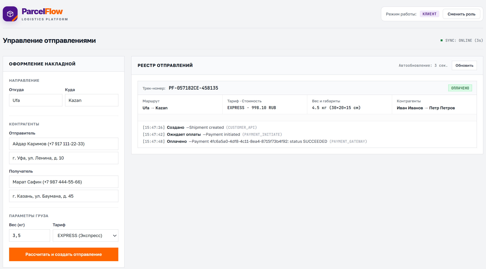

<p align="center">
  
</p>

<h1 align="center">ParcelFlow — Высоконадежная логистическая платформа</h1>

<p align="center">
  Промышленная backend-платформа на Go для управления доставкой посылок, координации жизненного цикла отправлений через детерминированный конечный автомат (State Machine), расчета стоимости доставки через gRPC, симуляции платежей с вебхуками и гарантированной рассылки событий через Transactional Outbox и NATS JetStream.
</p>

<p align="center">
  
  
  
  
  
  
  
</p>

---

## 📸 Интерфейс системы

Платформа оснащена встроенным веб-интерфейсом в строгом корпоративном стиле ведущих международных логистических операторов (FedEx, DHL). Интерфейс встроен прямо в Go-бинарник с использованием директивы `//go:embed` и предоставляет полноценный инструмент как для публичного трекинга клиентами, так и для оперативного контроля логистами.

### 1. Логистический портал и трекинг посылок
<p align="center">
  
</p>

- **Публичный трекер в реальном времени**: Ввод трек-номера (`TRK-...`) отображает текущий статус, тип тарифа, адреса маршрута, вес и габариты отправления.
- **Интерактивный прогресс-бар этапов доставки**: Визуализация продвижения посылки по строгой цепочке: `Created` ➔ `Paid` ➔ `Accepted` ➔ `In Transit` ➔ `Out for Delivery` ➔ `Delivered`.
- **Сводные KPI метрики**: Количество активных отправлений, суммарный финансовый оборот и процент успешных доставок на линии.
- **Хронологический аудит перемещений**: Подробный журнал каждого сканирования посылки операторами (сортировочный терминал, распределительный центр, курьерская доставка) с фиксацией геолокаций и точных меток времени.
- **Создание и управление отправлениями**: Встроенный калькулятор тарифа, генерация платежной ссылки и быстрое проведение оплаты.
- **Быстрое переключение ролей**: Переключение контекста между «Клиентом» и «Оператором склада» в 1 клик для демонстрации ролевой модели безопасности.

---

## 🎯 Бизнес-ценность и ключевые возможности

1. **Автоматизация полного цикла отправлений**: От создания заказа интернет-магазином до вручения адресату с проверкой каждого этапа бизнес-правилами.
2. **Гарантированный расчет тарифов (gRPC Engine)**: Динамический расчет стоимости с учетом объемного и физического веса, дальности маршрута и срочности (Стандарт, Экспресс, До двери).
3. **Финансовая надежность и идемпотентность**: Предотвращение двойных списаний при повторных кликах или сетевых сбоях через заголовки `X-Idempotency-Key` и атомарную регистрацию вебхуков платежного шлюза.
4. **Гарантированная доставка событий (Zero Data Loss)**: Паттерн **Transactional Outbox** в сочетании с **NATS JetStream** гарантирует, что ни одно событие смены статуса или уведомление клиенту не потеряется даже при аварийном завершении сервиса.
5. **Высокая производительность**: Архитектура на стандартной библиотеке Go (`net/http`) с прямым SQL (`database/sql` + `pgx/v5`), кэшированием горячих данных в Redis и защитой API от перегрузок (Rate Limiting).

---

## 🏗️ Архитектура системы

Проект спроектирован как единый высокопроизводительный модульный сервис на Go с разделением на независимые слои (Domain, Application, Infrastructure, Presentation):

```
                        +----------------------+
                        |   Веб-браузер / UI   |
                        | (Клиент / Оператор)  |
                        +----------+-----------+
                                   | HTTP / REST (JWT, Rate Limiting)
                                   v
+-------------------------------------------------------------------------+
|                              PARCELFLOW                                 |
|                                                                         |
|  +-------------------------------------------------------------------+  |
|  |             REST API & Web UI Server (HTTP :8080)                 |  |
|  +---------------------------------+---------------------------------+  |
|                                    |                                    |
|             gRPC (Protobuf / TCP)  |                                    |
|                                    v                                    |
|  +---------------------------------+---------------------------------+  |
|  |        gRPC Pricing Service (Расчет тарифов :50051)               |  |
|  +---------------------------------+---------------------------------+  |
|                                    |                                    |
|             HTTP Webhook           v                                    |
|  +---------------------------------+---------------------------------+  |
|  |    Payment Gateway Simulator (:8082) & HMAC Webhook Handler       |  |
|  +---------------------------------+---------------------------------+  |
|                                    |                                    |
|         Transactional Outbox       | ACID Transaction                   |
|         +--------------------------+-------------------------+          |
|         v                                                    v          |
|  +---------------+                                    +---------------+ |
|  | Outbox Poller |                                    | Event Worker  | |
|  +-------+-------+                                    +-------^-------+ |
+----------|----------------------------------------------------|---------+
           |                                                    |
           | domain.shipment.events                             | At-least-once
           v                                                    | subscription
   +------------------------------------------------------------+--+
   |                        NATS JetStream                         |
   +---------------------------------------------------------------+

                  +----------------+      +---------------+
                  |   PostgreSQL   |      |     Redis     |
                  |  (Source Truth)|      | (Cache/Limit) |
                  +----------------+      +---------------+
```

### Архитектурные паттерны:
- **Transactional Outbox Pattern**: Сохранение бизнес-сущности и события публикации происходит в единой транзакции PostgreSQL. Фоновый опросчик с блокировкой `SELECT ... FOR UPDATE SKIP LOCKED` безопасно вычитывает записи и отправляет их в брокер.
- **At-Least-Once Delivery & Idempotent Consumer**: NATS JetStream сохраняет поток событий на диск; обработчики подтверждают сообщения (`Ack`) только после успешного выполнения задачи. Повторные вебхуки отсекаются таблицей `processed_webhooks`.
- **HMAC-SHA256 Webhook Signatures**: Входящие события платежей и исходящие уведомления клиентам подписываются криптографическим ключом для подтверждения подлинности отправителя.
- **Token Bucket Rate Limiting**: Встроенный в middleware лимитер на базе Redis защищает endpoints от DDoS и спам-запросов.

---

## 🔄 Жизненный цикл отправления (State Machine)

В системе реализован детерминированный конечный автомат жизненного цикла посылки. Любые недопустимые или несанкционированные переходы блокируются бизнес-логикой ядра:

```
                      +-------------------+
                      |      CREATED      |  (Посылка создана в системе)
                      +---------+---------+
                                |
                                v
                      +-------------------+
                      |WAITING_FOR_PAYMENT|  (Ожидание подтверждения оплаты)
                      +----+---------+----+
                           |         |
         [Оплата успешна]  |         |  [Платеж отклонен]
                           v         v
                 +------------+   +----------------+
                 |    PAID    |   | PAYMENT_FAILED | (Терминальный)
                 +-----+------+   +----------------+
                       |
                       v
                 +------------+
                 |  ACCEPTED  |  (Принята оператором на сортировочном хабе)
                 +-----+------+
                       |
                       v
                 +------------+
                 | IN_TRANSIT |  (В процессе магистральной транспортировки)
                 +-----+------+
                       |
                       v
              +------------------+
              | OUT_FOR_DELIVERY |  (Передано курьеру для финальной доставки)
              +--------+---------+
                       |
                       v
                 +------------+
                 | DELIVERED  |  (Успешно вручено получателю — Терминальный)
                 +------------+

      * Примечание: Статус CANCELLED доступен до этапа OUT_FOR_DELIVERY.
```

### Бизнес-правила переходов:
1. **Создание и инициализация**: При создании посылка регистрируется со статусом `CREATED` с автоматическим расчетом стоимости через gRPC.
2. **Оплата**: Переход в статус `PAID` возможен только по входящему подтвержденному вебхуку от платежного шлюза.
3. **Складская обработка**: Только пользователи с ролью `OPERATOR` могут переводить отправление в статус `ACCEPTED` и вносить скан-события.
4. **Курьерская доставка**: Переход в `DELIVERED` невозможен минуя статус `OUT_FOR_DELIVERY`.
5. **Аудит**: Каждое изменение статуса фиксируется в неизменяемой таблице `shipment_events` с автором, временем и геолокацией.

---

## 📁 Структура репозитория

```
ParcelFlow/
├── .github/
│   └── workflows/
│       └── ci.yml               # GitHub Actions CI: проверка gofmt, тесты с race-детектором, сборка
├── docs/
│   └── images/                  # Логотипы и скриншоты системы
│       ├── logo.png
│       ├── logo.svg
│       └── dashboard.png
├── migrations/                  # Версионированные SQL-миграции схемы БД
│   ├── 000001_init_schema.up.sql
│   └── 000001_init_schema.down.sql
├── proto/                       # Protocol Buffers / gRPC спецификации
│   └── pricing/v1/
│       ├── pricing.proto
│       ├── pricing.pb.go
│       └── pricing_grpc.pb.go
├── internal/
│   ├── auth/                    # Аутентификация, генерация JWT токенов, bcrypt
│   ├── domain/                  # Чистые доменные сущности, State Machine, ошибки
│   ├── shipment/                # Бизнес-логика отправлений (Repository, Service, HTTP API)
│   ├── pricing/                 # gRPC-сервис расчета тарифов и клиент
│   ├── payment/                 # Симулятор платежного шлюза и HTTP-клиент вебхуков
│   ├── outbox/                  # Фоновый публикатор Transactional Outbox в NATS JetStream
│   └── notification/            # Обработчик очереди NATS для отправки вебхуков клиентам
├── pkg/
│   ├── httphelper/              # Сериализация JSON-ответов и обработка HTTP-ошибок
│   ├── logger/                  # Структурированный JSON-логгер (log/slog)
│   ├── nats/                    # Инициализация подключения и стримов NATS JetStream
│   ├── postgres/                # Пул соединений PostgreSQL и автомиграции
│   └── redis/                   # Клиент Redis (кэширование и Rate Limiter)
├── web/                         # Встроенный UI логистического портала
│   └── index.html               # Интерактивный дашборд и трекинг посылок
├── docker-compose.yml           # Декларативное развертывание всей инфраструктуры
├── Dockerfile                   # Многоэтапный легковесный Docker-образ
├── go.mod                       # Зависимости проекта
├── go.sum
├── main.go                      # Единая точка входа всей платформы
├── LICENSE                      # MIT Лицензия
└── README.md
```

---

## 🛠️ Стек технологий

| Категория | Технология / Библиотека | Назначение |
| :--- | :--- | :--- |
| **Язык разработки** | Go 1.26 | Высокопроизводительный компилируемый бэкенд |
| **HTTP Сервер** | `net/http` (`http.NewServeMux`) | Идиоматичный роутер стандартной библиотеки с валидацией методов |
| **RPC Фреймворк** | gRPC / Protobuf v3 | Высокоскоростной бинарный расчет стоимости доставки |
| **База данных** | PostgreSQL 16 (`pgx/v5`) | Реляционное хранилище, ACID-транзакции, `SKIP LOCKED` |
| **Брокер сообщений** | NATS JetStream | Гарантированная доставка доменных событий (At-least-once) |
| **Кэш и Rate Limit** | Redis 7 (`go-redis/v9`) | Кэширование трекинга и Token Bucket Rate Limiting |
| **Безопасность** | `golang-jwt/jwt/v5`, `bcrypt` | Ролевая безопасность (RBAC) и защита паролей |
| **Контейнеризация** | Docker, Docker Compose | Воспроизводимое локальное и продакшн развертывание |
| **CI / CD** | GitHub Actions | Автоматический линтинг, тестирование и верификация сборки |

---

## 👥 Роли и тестовые учетные записи

При первом старте система автоматически инициализирует тестовых пользователей:

| Роль | Email | Пароль | Назначение и права |
| :--- | :--- | :--- | :--- |
| **Оператор** (`OPERATOR`) | `operator@parcelflow.com` | `operator123` | Приемка отправлений на складе, регистрация скан-событий, смена статусов логистики |
| **Клиент** (`CUSTOMER`) | `customer@parcelflow.com` | `customer123` | Оформление заявок на доставку, оплата заказов, отслеживание своих посылок |

> 💡 **Быстрый вход в UI**: В шапке веб-интерфейса предусмотрены кнопки быстрого переключения ролей в 1 клик без необходимости ручного ввода логина и пароля.

---

## 🚀 Быстрый старт

### Требования
- Установленный [Docker](https://www.docker.com/) и Docker Compose.

### Развертывание всей инфраструктуры в 1 команду
Клонируйте репозиторий и запустите контейнеры:

```bash
git clone https://github.com/mensferrea/ParcelFlow.git
cd ParcelFlow
docker compose up --build -d
```

### Точки подключения:
- **Веб-интерфейс & REST API**: [http://localhost:8080](http://localhost:8080)
- **Симулятор платежного шлюза**: `http://localhost:8082`
- **gRPC Pricing Service**: `localhost:50051`
- **PostgreSQL**: `localhost:5432` (`user: postgres`, `password: postgres`, `db: parcelflow`)
- **Redis**: `localhost:6379`
- **NATS JetStream**: `localhost:4222`

Остановить сервисы и очистить тома:
```bash
docker compose down -v
```

---

## 📡 REST API Спецификация

| Метод | Эндпоинт | Роль | Описание |
| :--- | :--- | :--- | :--- |
| `POST` | `/api/v1/auth/login` | Публичный | Аутентификация пользователя и получение JWT-токена |
| `POST` | `/api/v1/shipments` | `CUSTOMER` / `OPERATOR` | Создание отправления с расчетом тарифа (`X-Idempotency-Key`) |
| `GET` | `/api/v1/shipments` | Любой авторизованный | Список отправлений текущего пользователя / всех для оператора |
| `GET` | `/api/v1/shipments/{id}` | Любой авторизованный | Детальная информация об отправлении |
| `GET` | `/api/v1/shipments/track/{tracking_number}` | Публичный | Публичный трекинг посылки по трек-номеру |
| `POST` | `/api/v1/shipments/{id}/pay` | `CUSTOMER` | Инициализация оплаты через платежный симулятор |
| `POST` | `/api/v1/shipments/{id}/status` | `OPERATOR` | Перевод статуса посылки по State Machine |
| `POST` | `/api/v1/shipments/{id}/events` | `OPERATOR` | Добавление скан-события перемещения (сортировка, терминал) |
| `POST` | `/api/v1/payments/webhook` | Внутренний | Входящий вебхук платежной системы с HMAC-подписью |
| `GET` | `/health` | Публичный | Проверка жизнеспособности сервиса |

---

## 🧪 Тестирование

Проект покрыт автоматическими тестами бизнес-логики конечного автомата, доменных правил и gRPC-сервиса:

```bash
# Запуск всех модульных тестов с детектором гонок
go test -v -race ./...

# Проверка сборки единого исполняемого файла
go build -v ./main.go
```

---

## 📄 Лицензия

Проект распространяется под открытой лицензией [MIT](LICENSE).
